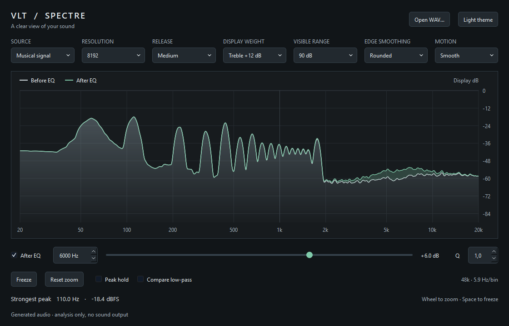

# VLT Spectre

A small C++17 audio spectrum library with a reusable Qt 6 view. Capture audio, measure its spectrum, and choose how to present it in your own application.

[По-русски](README.ru.md) · [Integration guide](docs/integration.md) · [How it works](docs/architecture.md) · [MIT license](LICENSE)



## What is included

- **Independent DSP core:** stereo power analysis, calibrated Hann-windowed FFT, logarithmic frequency points, attack/release, peak hold and freeze. No Qt, audio device or external DSP library is required.
- **Rounded spectrum:** optional presentation smoothing gives narrow peaks rounded shoulders; shared spline tangents remove angular joins. Two-stage damping keeps motion continuous when targets change.
- **Readable treble:** a configurable visual shelf rises from 2 to 16 kHz. Its default +12 dB setting leaves 500–2000 Hz unchanged. A conventional dB/octave tilt is also available.
- **Layers:** arbitrary input, output, sidechain and reference traces, explicit drawing order, independent colors, and transparent fill between two traces.
- **Optional Qt widget:** dark/light themes, resize-aware labels, pointer-anchored zoom, pan, keyboard inspection and numeric accessibility text. No application-global styling or audio ownership.
- **Working examples:** console analysis and a silent desktop demo with WAV import and a real adjustable EQ for before/after comparison.

The demo's controls and EQ are examples, not required parts of the library. There is no DAW dependency, bundled plugin format, audio driver, or built-in JUCE view. Use the core with your own renderer if your application does not use Qt.

## Build

Requirements: a C++17 compiler and CMake 3.20+. Qt 6.2+ Widgets is needed only for the optional view and desktop example.

```sh
# Core, console example and DSP tests — no Qt required.
cmake -S . -B build-core -DCMAKE_BUILD_TYPE=Release
cmake --build build-core --config Release
ctest --test-dir build-core -C Release --output-on-failure

# Optional view and demo. Set CMAKE_PREFIX_PATH if Qt is not discoverable.
cmake -S . -B build -DCMAKE_BUILD_TYPE=Release -DVLT_SPECTRE_BUILD_WIDGETS=ON
cmake --build build --config Release
ctest --test-dir build -C Release --output-on-failure
```

Windows shortcut, with Visual Studio C++ Build Tools, CMake and Ninja installed:

```powershell
.\build.ps1 -QtPath C:\Qt\6.8.3\msvc2022_64
.\build\spectre_demo.exe
# For the independent core:
.\build.ps1 -CoreOnly -BuildDirectory build-core
```

The script finds the compiler environment, builds, tests, and deploys Qt runtime files beside the demo. Other platforms can use the ordinary CMake commands above. The executable's directory is a local build output, not a prebuilt release in this repository.

## Add to an existing project

Copy or clone the repository into a vendor directory:

```cmake
add_subdirectory(vendor/VLT-Analyze-Spectre)
target_link_libraries(your_target PRIVATE VltSpectre::Core)
```

As a subdirectory, examples, tests and Qt are **off by default**. To opt into the widget:

```cmake
set(VLT_SPECTRE_BUILD_WIDGETS ON CACHE BOOL "Build Spectre Qt view")
add_subdirectory(vendor/VLT-Analyze-Spectre)
target_link_libraries(your_target PRIVATE VltSpectre::Widgets)
```

There is also an installable CMake package; see the [integration guide](docs/integration.md).

```cpp
#include <vlt/spectre/Analyzer.hpp>
vlt::spectre::Analyzer analyzer;

// During setup, with audio and consumer calls stopped:
std::string error;
if (!analyzer.prepare(48000.0, {}, &error)) {
    // Report error to the host; do not start capture with invalid settings.
}

// Audio callback: one producer, no allocation, locks or FFT here.
analyzer.pushStereo(leftSamples, rightSamples, frameCount);

// UI timer or analysis worker: one consumer, typically 30–60 Hz.
if (analyzer.read()) {
    const auto& frame = analyzer.frame();
    // frame.frequenciesHz and frame.levelsDb are ready for your renderer.
}
```

Call `prepare()` and destroy the analyzer only after both sides stop. The frame belongs to the consumer: copy or hand it off safely if a different thread renders it. [Full threading contract](docs/integration.md#thread-ownership).

## Before / after layers

Feed separate analyzers with actual samples before and after your effect. Apply the same analyzer settings and visual weighting to both. The widget is not an EQ simulator and does not invent the processed spectrum.

```cpp
using namespace vlt::spectre;
TraceStyle original;
original.label = "Before EQ";
original.zOrder = 0;
widget.setTrace("before", beforeAnalyzer.frame(), original);

TraceStyle processed;
processed.label = "After EQ";
processed.line = QColor("#80cbaa");
processed.fill = QColor(128, 203, 170, 60); // Translucent difference area.
processed.zOrder = 10;
processed.fillReference = "before";       // Fill between these two curves.
widget.setTrace("after", afterAnalyzer.frame(), processed);
```

Leave `fillReference` empty for a normal fill down to the graph floor, or set `filled = false` for a line only. Lower `zOrder` draws first. Use `setTraceStyle()` to change appearance even while the display is frozen.

## Try the demo

- **Open WAV…** or drag a WAV file onto the window. The demo analyzes the file in a loop; it intentionally produces no sound.
- Change the EQ frequency, gain slider and Q to compare **Before EQ** with **After EQ**. Clicking a frequency on the graph also moves the demo's EQ band.
- **Display weight → Treble +12 dB** improves visibility above 2 kHz without a midrange boost. **Flat** restores the unweighted scale.
- **Edge smoothing → Rounded** controls the spatial envelope. **Motion → Smooth** controls presentation damping. Both can be disabled independently.
- Wheel zooms around the pointer, middle-drag pans, double-click/Home resets; arrow keys inspect, Space freezes.
- The WAV reader accepts little-endian PCM 8/16/24/32-bit and float32, up to 128 MiB. Mono is duplicated; multichannel files use their first two channels.

## Measurement and display are separate

`instantaneousDb` is the current measurement; `levelsDb` adds time-domain ballistics; `peaksDb` adds peak hold. All are unweighted peak-amplitude dBFS. A bin-centred full-scale sine present in both channels reads 0 dBFS; the same sine in one stereo channel reads approximately -3.01 dBFS. Opposite channel phases do not cancel.

Visual smoothing, treble weighting and tilt do not change these arrays. When weighting is active, the graph explicitly says **Display dB**; the cursor and strongest-peak readout still report unweighted dBFS. Rounding can broaden resonances and merge close peaks: use the numeric data for measurements, or turn visual smoothing off.

This is an amplitude spectrum, not a loudness meter or power spectral density estimator. Noise height depends on FFT size and display aggregation. At 48 kHz, 8192 samples span about 171 ms with 5.86 Hz bin spacing; larger windows improve bass resolution at the cost of time resolution. Peak interpolation is an estimate, not a guarantee of sub-bin accuracy.

## Source map and checks

| Location | Responsibility |
| --- | --- |
| `include/vlt/spectre`, `src` | Public core API, capture, FFT and portable visual envelope |
| `qt/include`, `qt/src` | Optional widget, geometry, motion and layer composition |
| `examples` | Host UI, sample generator, WAV reader and demonstration EQ |
| `tests` | Calibration, lifecycle, threading, allocation, geometry and overlay checks |
| `docs` | Integration, architecture and rendered demo images |

CTest covers known tones, anti-phase stereo, Nyquist handling, callback allocation, concurrent capture/reset, smoothing continuity, treble isolation, real EQ gain and layer rendering. GitHub Actions is configured for core builds on Windows/macOS/Linux and the optional Qt view on Linux. Actual CI results are visible in the repository's Actions tab.

MIT licensed. The original repository copyright notice is retained in [LICENSE](LICENSE). Qt and any other host dependencies retain their own licenses. Contributions should keep the core independent and document public behavior changes; use the tests for changes to measured output or threading.
